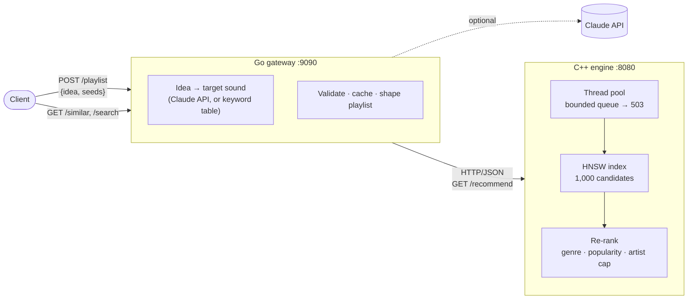

# Playlist Engine

[](https://github.com/lelili23/playlist-engine/actions/workflows/ci.yml)

A music recommendation service built from scratch: a **C++20 engine** with a hand-written
**HNSW vector index**, a **multithreaded HTTP server** on raw POSIX sockets, and a **Go gateway** that turns playlist
ideas like *"rainy day study"* into songs.

- **Similar songs:** give it a song, get the most similar ones, re-ranked for genre fit and variety.
- **Playlist from an idea:** describe a mood in words (plus optional seed songs), get a playlist.

| | |
|---|---|
| Catalog | 78,760 unique songs (Spotify audio features) |
| HNSW vs. exact search | **100% recall@20, 17× faster** (79k songs); **99× faster** at 1M |
| Throughput | **~2,300 req/s, 0 errors** under load on 2 vCPUs |
| Startup | **0.37 s** from a saved index (vs. ~5 s to rebuild) |
| Tests | 73 C++ (GoogleTest, clean under ASan, UBSan, TSan) + 16 Go (race detector) |
| Dependencies | None at runtime: C++ standard library + POSIX, Go standard library |

## Architecture



Each language does what it's best at: **C++** for the latency-critical search, **Go** for
network glue (the HTTPS call to the LLM, JSON validation, goroutine-per-request concurrency).

## Quick start

Linux, macOS or WSL. Needs CMake ≥ 3.24, a C++20 compiler (GCC 12+ / Clang 15+), and Go ≥ 1.22.

```bash
# Ubuntu / WSL (C++ toolchain)
sudo apt install -y build-essential cmake ninja-build libgtest-dev
# Go: apt's version may be older than 1.22, so install the latest from go.dev
GOV=$(curl -s 'https://go.dev/VERSION?m=text' | head -1)
curl -LO "https://go.dev/dl/$GOV.linux-amd64.tar.gz"
sudo rm -rf /usr/local/go && sudo tar -C /usr/local -xzf "$GOV.linux-amd64.tar.gz"
export PATH=$PATH:/usr/local/go/bin

cmake -S . -B build -G Ninja -DCMAKE_BUILD_TYPE=Release
cmake --build build && ctest --test-dir build
```

Download `dataset.csv` from the [Spotify Tracks Dataset](https://www.kaggle.com/datasets/maharshipandya/-spotify-tracks-dataset)
into `data/`. (No data? `python3 scripts/make_fake_csv.py 100000 data/fake.csv` makes a file with the same schema.)

```bash
# terminal 1: engine (first start builds and saves the index; later starts load it)
./build/plgen_server --csv data/dataset.csv --index data/index.bin

# terminal 2: gateway (set ANTHROPIC_API_KEY to use Claude; otherwise a keyword table is used)
cd gateway && go run . -engine http://localhost:8080

# try it
curl "localhost:9090/search?q=somebody%20else&limit=3"
curl "localhost:9090/similar?song=4m0q0xQ2BNl9SCAGKyfiGZ&k=10"
curl -X POST localhost:9090/playlist -H 'content-type: application/json' \
     -d '{"idea": "rainy day study", "length": 20}'
```

## API

**Gateway** (`:9090`, public):

| Endpoint | Does |
|---|---|
| `POST /playlist` `{"idea", "seeds": [ids], "length": 5–100}` | Playlist from an idea and/or seed songs. Reports where the target came from (`llm`, `fallback`, `cache:llm`, `seeds-only`). |
| `GET /search?q=&limit=` | Find songs by title or artist (proxied to the engine) |
| `GET /similar?song=<id>&k=` | Songs similar to one song (proxied to the engine) |
| `GET /health` | Gateway, engine and LLM status |

**Engine** (`:8080`, internal): `/health`, `/search`, `/similar`, `/genres`, and
`/recommend?energy=&valence=&...&genres=&seeds=&k=`. Bad input gets `400`, unknown ids
`404`, and an overloaded queue `503`.

## How it works

### 1. Songs become vectors

Each song becomes 10 normalized numbers. Every dimension is scaled by √weight, so plain
squared Euclidean distance equals the *weighted* distance, and brute force and HNSW share one
distance function.

| Feature | Transform | Weight |
|---|---|---|
| energy, valence (mood) | 0–1 as given | 1.0 |
| danceability, acousticness | 0–1 as given | 0.7 |
| tempo | clip to 1st–99th percentile, scale to 0–1 | 0.8 |
| key (2 dims) | angle on the **circle of fifths** → (cos, sin); minor keys mapped to their relative major; unknown → centre | 0.3 |
| mode | major 1, minor 0 | 0.2 |
| speechiness | clip at 0.5, stretch to 0–1 (separates rap from singing) | 0.8 |
| instrumentalness | 0–1 as given | 0.6 |

The loader parses RFC 4180 CSV (quoted commas, escaped quotes, multi-line fields) and cleans
the data: 114,000 rows become 78,760 songs once tempo-0 rows, the same track listed once per
genre, and re-releases of the same song under new ids are merged or dropped. Titles are compared
without version decorations, so "One Kiss", "One Kiss (with Dua Lipa)" and "One Kiss - Remastered"
count as one song.

### 2. HNSW index (from the paper, no libraries)

[Hierarchical Navigable Small World](https://arxiv.org/abs/1603.09320) graphs: every song is a
node linked to ~16–32 similar songs; a random ~1/16 also appear on a sparser layer above, and so
on. A search greedily hops down through the sparse layers, then does a best-first search on the
bottom layer, keeping `ef` candidates (the speed vs. accuracy dial). Neighbors are chosen with the
paper's **diversity heuristic**, so links fan out instead of clumping into one cluster.

### 3. Retrieve, then re-rank

HNSW retrieves the 1,000 nearest songs; a second pass re-scores them with signals the vector
doesn't hold:
- **Genre relatedness learned from the data.** Genres that often tag the *same* songs are related:
  `songs with both / songs in the smaller genre` (alt-rock vs. alternative 0.65, vs. metal 0.2,
  vs. sertanejo 0). Unrelated genres are penalized. Precomputed as a matrix with integer genre ids.
- A popularity bonus, a penalty for near-zero-popularity duplicates, and **≤ 2 songs per artist**.

### 4. Idea to playlist

The gateway sends the idea plus the engine's 114 genre names to Claude, which returns target
values and up to 4 genres as JSON. That output is **treated as untrusted input**: numbers are
clamped, unknown genres dropped, and any failure falls back to a keyword table (matched at word
starts, so "workout" doesn't match "work"). The engine converts the target with the *same*
normalizer as the songs, blends it 50/50 with any seed songs, then retrieves and re-ranks.

### 5. Server and concurrency

The main thread `poll()`s and `accept()`s; a fixed thread pool with a **bounded queue** handles
requests and answers `503` immediately when full (backpressure, not unbounded queuing). Sockets
have timeouts and request size limits, and are closed via RAII. The engine is immutable after
startup, so workers share it **without locks**. Ctrl+C drains in-flight requests before exiting.

## Performance

All numbers come from a 2-vCPU cloud VM, single-threaded unless noted.

**HNSW vs. brute force** (k = 20, M = 16, ef_construction = 200), via `plgen_bench_hnsw`:

| Catalog | Method | Recall@20 | Mean latency | Songs compared | Speedup |
|---|---|---|---|---|---|
| 78,760 real songs | brute force | 1.000 | 474 µs | 78,760 | 1× |
| | HNSW ef=20 | 0.997 | 18 µs | 255 | 26× |
| | HNSW ef=40 | 1.000 | 29 µs | 372 | 17× |
| 1,000,000 synthetic | brute force | 1.000 | 7.0 ms | 1,000,000 | 1× |
| | HNSW ef=40 | 0.998 | 71 µs | 688 | **99×** |

**Index build and startup.** Parallel insertion with one mutex per node plus a global lock for the
entry point; the locks are freed after the build, so queries are lock-free.

| | Time |
|---|---|
| Build, 1 thread | 8.6 s |
| Build, 2 threads | 4.6 s (1.9×, recall unchanged) |
| Start by loading the saved index (5.2 MB) | **0.37 s** |

The index file carries a fingerprint of the song vectors, is validated on load (counts, ids,
levels), and is written to a temp file and renamed. An index for different data, or a truncated
or corrupt file, is rebuilt automatically.

**Load test** with `plgen_loadtest`: C++ closed-loop clients, a new TCP connection per request,
and the client sharing the server's 2 vCPUs.

| Clients | `/similar` req/s | p50 | p99 | Errors / 503s |
|---|---|---|---|---|
| 1 | 890 | 1.06 ms | 1.9 ms | 0 / 0 |
| 4 | 2,376 | 1.65 ms | 2.6 ms | 0 / 0 |
| 16 | 2,341 | 6.7 ms | 9.0 ms | 0 / 0 |
| 64 | 2,229 | 27.4 ms | 42.1 ms | 0 / 0 |

Throughput saturates once both cores are busy; past that, latency rises per Little's Law
(64 / 2,229 req/s ≈ 29 ms). `/health` alone does ~53k req/s, so search, not HTTP, is the bottleneck.

## Testing

```bash
ctest --test-dir build                                    # 73 C++ tests

# AddressSanitizer + UBSan (memory bugs), then ThreadSanitizer (data races)
cmake -S . -B build-asan -DCMAKE_BUILD_TYPE=Debug -DPLGEN_SANITIZE=ON
cmake --build build-asan && ctest --test-dir build-asan
cmake -S . -B build-tsan -DCMAKE_BUILD_TYPE=Debug -DPLGEN_TSAN=ON
cmake --build build-tsan && ctest --test-dir build-tsan

cd gateway && go test -race ./...                         # 16 Go tests
```

Highlights: HNSW recall is checked against brute force; the parallel build is checked for graph
invariants and data races; a real-socket test sends 320 requests from 16 concurrent clients;
the Go tests run against a fake engine and a fake Claude API (offline, free).

All of the above runs automatically in GitHub Actions on every pull request and every push to
`main` (see `.github/workflows/ci.yml`): three C++ builds (Release, ASan + UBSan, TSan) and the
Go tests with the race detector.

## Design decisions and trade-offs

- **Hand-written HTTP server.** Chosen to learn sockets, thread pools and backpressure. In
  production I'd use a battle-tested framework or put a proxy in front: HTTP isn't the bottleneck,
  and a hand-written parser is attack surface.
- **HTTP/JSON between Go and C++, not gRPC.** Avoids a heavy C++ dependency; gRPC is a clean
  next step.
- **1,000 retrieval candidates.** 200 is ~4× faster, but good same-genre picks drop out and
  unrelated genres return. Quality won.
- **One request per connection.** Simple and correct; keep-alive would raise throughput.

## Limitations

- 10 audio features describe a song's *vibe* (energy, mood, tempo), not its style or language, so
  "similar" songs can sound alike on paper but not to a listener. Richer signals (co-listening data,
  audio embeddings) aren't available in this dataset.
- The dataset is a fixed snapshot: Spotify no longer offers audio features to new apps.
- Single node, no TLS, no keep-alive.

## Project layout

```
include/plgen/   C++ headers             src/core/   C++ implementation
apps/            server, benchmarks, load tester, similar-song CLI
tests/           GoogleTest suites       gateway/    Go gateway (standard library only)
scripts/         data helpers            data/       dataset, saved index (gitignored)
```
