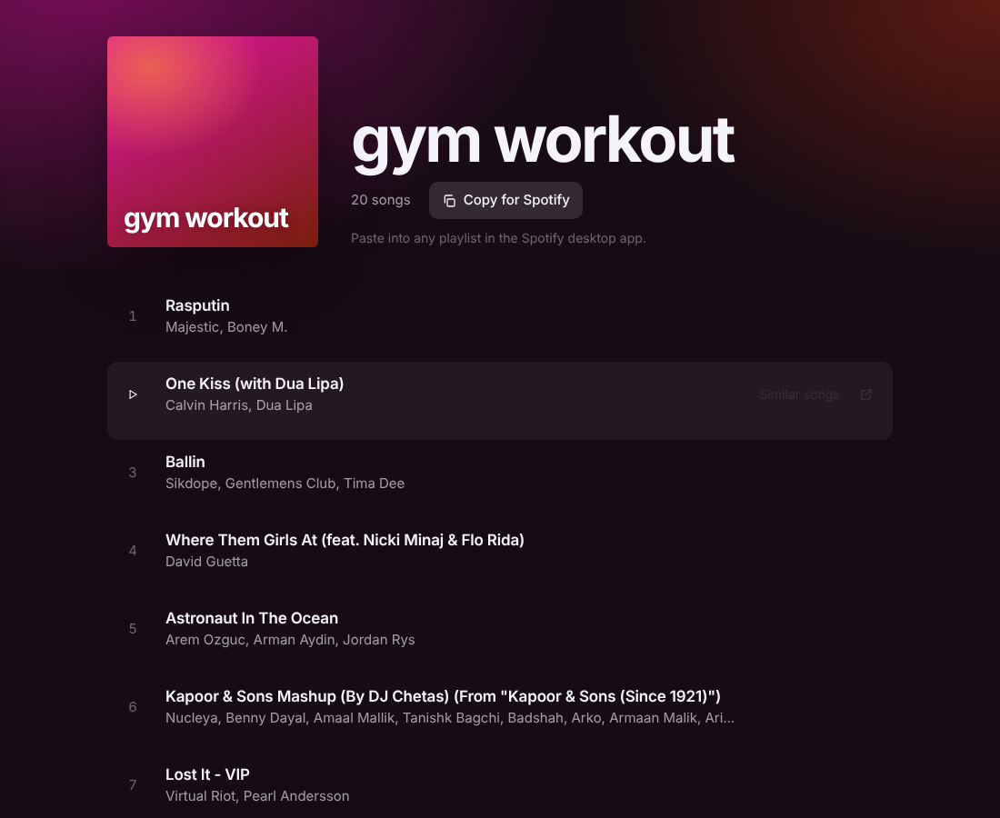
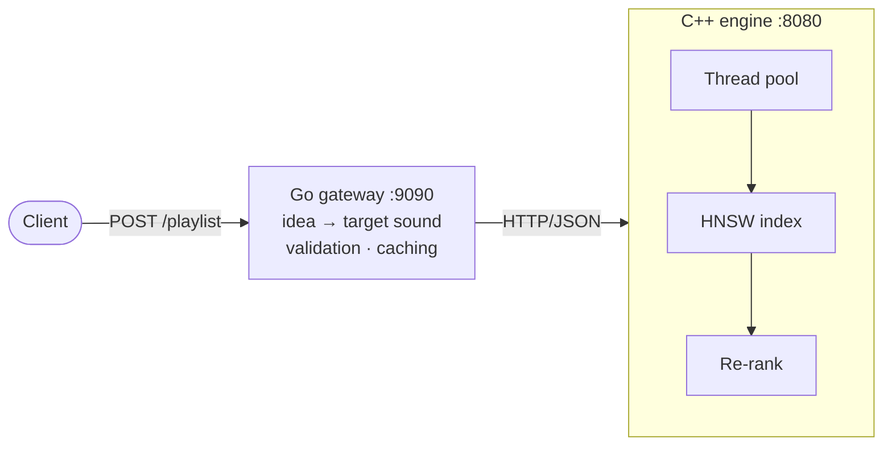

# Playlist Engine

[](https://github.com/lelili23/playlist-engine/actions/workflows/ci.yml)

A music recommendation service: a **C++20 engine** with a hand-written **HNSW vector index** and a
**multithreaded HTTP server** on POSIX sockets, behind a **Go gateway** and web UI that turn ideas
like *"rainy day study"* into playlists.



| | |
|---|---|
| Catalog | 78,760 songs (Spotify audio features) |
| Search | 100% recall@20, **17× faster** than brute force (99× at 1M songs) |
| Throughput | ~2,300 req/s, 0 errors under load (2 vCPUs) |
| Startup | 0.37 s from a saved index |
| Tests | 73 C++ (ASan, UBSan, TSan clean) + 17 Go (race detector), run in CI |

## Architecture



## Run it

Needs CMake ≥ 3.24, a C++20 compiler, GoogleTest, and Go ≥ 1.22. Put `dataset.csv` from the
[Spotify Tracks Dataset](https://www.kaggle.com/datasets/maharshipandya/-spotify-tracks-dataset) in `data/`.

```bash
cmake -S . -B build -DCMAKE_BUILD_TYPE=Release && cmake --build build
./build/plgen_server --csv data/dataset.csv --index data/index.bin   # engine on :8080
cd gateway && go run .                                               # gateway + UI on :9090

curl -X POST localhost:9090/playlist -d '{"idea": "rainy day study", "length": 20}'
curl "localhost:9090/similar?song=4m0q0xQ2BNl9SCAGKyfiGZ&k=10"
```

## How it works

- **Songs → vectors.** 10 normalized, weighted audio features per song (energy, mood, tempo, key on
  the circle of fifths, ...), so similarity is plain Euclidean distance.
- **HNSW.** A layered graph built from the paper, with no libraries. Searches hop through sparse upper
  layers, then search the bottom layer. Built in parallel and saved to disk.
- **Retrieve, then re-rank.** HNSW fetches 1,000 candidates, then re-ranks them using genre
  relatedness learned from tag co-occurrence, popularity, and a per-artist cap.
- **Server.** POSIX sockets with a bounded thread pool. A full queue answers `503` right away.
  The index is read-only after startup, so requests share it without locks.
- **Gateway.** Turns an idea into a target sound with a keyword interpreter, then asks the
  engine for the nearest songs.

- **Web UI.** One page embedded in the gateway. The page's colors come from the vibe (mood sets
  the hue, energy the intensity). Songs play inline through Spotify's player, and "Copy for
  Spotify" pastes the playlist into the Spotify desktop app.

## Performance

| 78,760 songs, k = 20 | Recall | Latency | Songs compared |
|---|---|---|---|
| Brute force | 1.000 | 474 µs | 78,760 |
| HNSW, ef = 40 | 1.000 | 29 µs | 372 |

Benchmarks: `plgen_bench_hnsw` (search), `plgen_loadtest` (HTTP throughput).

## Tests

```bash
ctest --test-dir build                 # C++ (add -DPLGEN_SANITIZE=ON or -DPLGEN_TSAN=ON for sanitizers)
cd gateway && go test -race ./...      # Go
```
